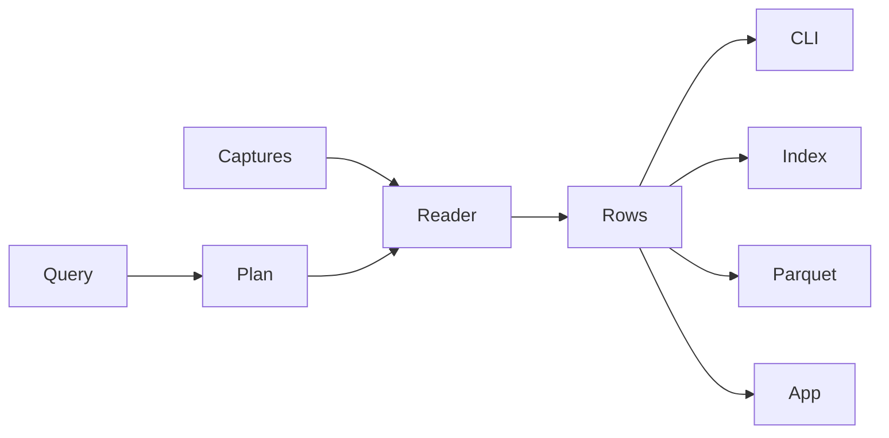

# fin

> TLS server names on a 368 MB capture: 0.226 seconds, against 7.87 seconds for tshark 4.6.9. Same 1,252 names. Preliminary, from a prototype that has since been removed.

**Status:** `fin -r <file> [-n] -T fields -e ip.src` and `-e tls.handshake.extensions_server_name` map the file, split a classic pcap across cores, and print the field. pcapng and stdin use the sequential reader. Next is HTTP.

fin is an open-source packet analyzer.

A capture file is a recording of packets. A packet is one message sent across a network: a few headers, then the contents. Wireshark is the usual program for opening these files. tshark is its command-line version.

## How fin differs from tshark

tshark and Wireshark decode every layer of every packet, then show you the part you asked about. On tshark 4.6.9, `-e ip.src` takes about as long as `-e frame.number`. Disabling UDP, TCP, DNS, HTTP, TLS, and data saves about 22%. The time is the per-packet engine.

fin compiles the question into one plan and reads only the bytes that plan needs. The same rows answer the CLI, an index over a directory of captures, a Parquet export, and a desktop app. The app replaces Wireshark: it decodes the packets on screen, not the whole file.

fin may print less than tshark with default preferences. It never prints a different value. A value it cannot prove is dropped, that packet is counted, and the process exits nonzero.

## How it works

The CLI takes tshark's flags and filters. A query compiles to one plan. The reader follows that plan through the captures and emits rows of proved values, at the speed of memory or disk.



A capture file becomes frames: link type and the captured bytes. A classic pcap is mapped and split across cores. Each core proves that its chunk starts where the previous one stopped. A seam that does not prove is reread by the sequential reader, front to back on one core. pcapng, stdin, and live capture use that reader too.

Header fields are read from the packet in hand. A field that spans packets, such as a TLS server name, is reassembled on the connection and written on the packet that completes it. Rows from every core merge back into file order.

Those rows are the product. The CLI prints them as `-T fields`. The index answers the same query over an archive of captures. Parquet is the export. The desktop app is the Wireshark replacement, and it decodes only the packets on screen.

## How correctness is checked

Matching tshark is the product, so the checker is built first. It runs tshark 4.6.9 and fin on the same files and compares the output line by line. tshark always runs with an empty config directory, so personal preferences can't change the result. Two rules must hold on every test file:

- Every line where fin differs from tshark is a packet fin counted.
- On a counted packet, every value fin printed is one tshark printed.

The output is pinned to tshark 4.6.9. When the target version moves, its port tables are snapshotted again.

## What v1 supports

```
fin -r capture.pcapng -T fields -e ip.src -e tls.handshake.extensions_server_name
```

- **Fields:** `ip.src` (the IPv4 source address) and `tls.handshake.extensions_server_name` (the TLS server name).
- **Flags:** `-r`, `-n`, `-T fields`, `-e`, and `-o tcp.reassemble_out_of_order:TRUE`.
- **Files:** classic pcap and pcapng.
- **Link types:** Ethernet, Linux cooked capture (SLL and SLL2).

Any other field, flag, or display filter is an error, never a silently empty column. On a classic pcap, any other link type is an error too: the file fails before any row. A pcapng file can mix interfaces, and an unsupported interface there is a counted frame. fin prints numeric addresses and never looks up names.

## Build order

Each step is checked against the one before it.

1. The checker and a corpus of test captures. Done.
2. The sequential reader. Done. `read_capture` reads a file front to back on one core and returns frames: link type and the captured bytes. Tests cover the four pcap magics, pcapng blocks, and the file faults tshark 4.6.9 raises, including ISB, NRB, DSB, custom blocks, and systemd journal export.
3. `ip.src`. Done. The walker covers Ethernet, classic SLL, SLL2, VLAN, QinQ, IPv4, IPv6 extension headers, ICMP errors, IP-in-IP, and VXLAN. UDP/TCP use the snapshotted tshark 4.6.9 port table. Any path it cannot prove is counted on stderr. HTTP is not in this step.
4. The chunk split. Done. A mapped classic pcap is split across cores. Each core proves its start is the byte where the previous chunk stopped. A seam that does not prove is reread by `read_capture`. pcapng stays sequential: hopping blocks in parallel still peels frames in file order, and the measured win is on pcap. Tests diff chunked frames against the sequential reader, including adversarial pcap payloads and the file faults tshark 4.6.9 raises.
5. TLS server names. Done. One TCP payload, one TLS record, the ClientHello `server_name` / `host_name` extension. A handshake that needs reassembly, a second TLS record, QUIC, or DTLS is counted. Notes: `docs/tls-sni.md`.
6. HTTP.

After TLS server names, QUIC Initials are decrypted and read with the same ClientHello parser. The index, the Parquet export, and the desktop app follow.

## Preliminary experiments

These figures come from a throwaway prototype on 9 Oct 2026. They are not a product benchmark, and the prototype has been removed.

| Query | Capture | tshark 4.6.9 | prototype |
| --- | --- | ---: | ---: |
| TLS server name | bigFlows.pcap, 368 MB, 791,615 packets | 7.87 s | 0.226 s |
| `ip.src` | 1,000,000 Ethernet + IPv4 + UDP packets, 74 MB | 7.97 s | 0.056 s |
| `ip.src` | 1,000,000 QinQ + IPv4 + UDP packets, 82 MB | 8.83 s | 0.057 s |

TShark 4.6.9 (`v4.6.9-0-g2d548b197c75`). Intel Core i9-14900HX, 32 GB RAM, Windows 11. One warmup, then the median of three runs, so files were read from a warm cache. Stdout discarded. tshark was passed `-n`.

The prototype's `ip.src` output matched tshark on both million-packet files. The TLS names matched too, including tshark's blank line for a retransmitted ClientHello.

The prototype did not reassemble split TLS handshakes. bigFlows.pcap is older traffic, where every handshake fits in one packet. Modern browsers often split them, and the real reader handles that, so its numbers will differ.

Inside tshark, the `ip.src` query costs about the same as printing the packet number. Disabling UDP, TCP, DNS, HTTP, TLS, and data dissection in tshark saves only 22%. The cost is tshark's per-packet engine itself.

Notes: `study/mechanism.md`, `study/benchmark.md`, `study/spike.md`.

## ip.src, 13 Oct 2026

Same machine and method as the table above. Release `fin`, stdout and stderr discarded, one warmup, median of three.

| Query | Capture | tshark 4.6.9 | fin |
| --- | --- | ---: | ---: |
| `ip.src` | 1,000,000 Ethernet + IPv4 + UDP, 74 MB | 7.55 s | 1.01 s |
| `ip.src` | 1,000,000 QinQ + IPv4 + UDP, 82 MB | 8.59 s | 1.02 s |

Counted-frame rate on real files: 0% on the 10-packet public VXLAN sample, 63% on challenge01 (1,670 packets), 59% on bigFlows (791,615 packets). Most of those counts are TCP payloads whose port dissector may reject (HTTP, TLS) or can reach IP. The walker does not model those accept paths yet.

## Frame walk, 10 Oct 2026

Same machine and method as the table above. The file is the million-packet Ethernet capture. tshark printed `frame.number`. fin walked frames and did not extract a field.

| Walk | Time |
| --- | ---: |
| tshark 4.6.9 `-e frame.number` | 7.69 s |
| fin process | 0.057 s |
| fin in-memory walk | 0.019 s |

The process time is 136× the tshark floor. The 0.038s between process start and the in-memory walk is the next cut.

## Chunk split, 19 Oct 2026

Linux VM, 4 cores. One warmup, then the median of three, warm cache. The walk is frames only, no `ip.src`.

| Walk | Capture | Time |
| --- | --- | ---: |
| sequential `read_capture` | 1,000,000 Ethernet + IPv4 + UDP, 74 MB | 0.0085 s |
| chunked, 4 threads | same | 0.0044 s |

`fin -e ip.src` on that file, stdout discarded, was 0.311 s. Rows still merge and the ip.src walk stays sequential.

## License

MIT
