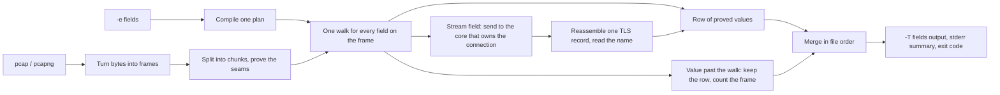

# fin

> TLS server names on a 368 MB capture: 0.226 seconds, against 7.87 seconds for tshark 4.6.9. Same 1,252 names. Preliminary, from a prototype that has since been removed.

**Status:** design locked. No reader yet.

fin is an open-source packet analyzer. tshark decodes every layer of every packet, then prints the field you asked for. fin turns the fields you ask for into one plan and reads only the bytes that plan needs. On the fields it supports, fin may print less than tshark 4.6.9 with default preferences. It never prints something different.

A capture file is a recording of packets. A packet is one message sent across a network: a few headers, then the contents. Wireshark is the usual program for opening these files. tshark is its command-line version.

## What v1 supports

```
fin -r capture.pcapng -T fields -e ip.src -e tls.handshake.extensions_server_name
```

- **Fields:** `ip.src` (the IPv4 source address) and `tls.handshake.extensions_server_name` (the TLS server name).
- **Flags:** `-r`, `-n`, `-T fields`, `-e`, and `-o tcp.reassemble_out_of_order:TRUE`.
- **Files:** classic pcap and pcapng.
- **Link types:** Ethernet, Linux cooked capture (SLL and SLL2).

Any other field, flag, or display filter is an error, never a silently empty column. On a classic pcap, any other link type is an error too: the file fails before any row. A pcapng file can mix interfaces, and an unsupported interface there is a counted frame. fin prints numeric addresses and never looks up names.

## How it works



**1. Frames.** pcap and pcapng are adapters. Each one turns the file into frames: link type, timestamp, original length, and the captured bytes. Nothing after this step knows which file format it came from.

**2. Chunks.** The file is memory-mapped and cut into one chunk per core. Each core finds the first packet boundary inside its chunk and reads until it finishes the packet that crosses its end. The split is proven when every chunk starts exactly where the previous one stopped, beginning at the start of the file. Where a seam doesn't line up, that stretch is reread with the sequential reader.

The sequential reader reads front to back on one core. It is not the fast path. It checks the chunk split (both must produce identical output), rereads failed seams, and will later read stdin and live captures, which can't be split.

**3. The plan.** Before reading any packets, fin compiles the requested fields into one plan: a route through a graph of protocols. Fixed headers (Ethernet, VLAN, IPv4, IPv6, TCP) are stored as tables of offsets. Variable messages, like the TLS ClientHello, are small parsers. Several fields share one walk, so asking for two fields doesn't read each packet twice.

**4. The walk.** Each frame is walked from its link type: past VLAN and QinQ tags, through IPv4 or IPv6 and its extension headers, to TCP. The walk stops as soon as the plan has what it needs. ICMP error messages carry a copy of the original IP header, so they print a second `ip.src`, just as tshark does.

**5. Connections.** Header fields like `ip.src` need nothing beyond the packet itself, so every core works independently. The TLS server name can span several packets. For that field, each TCP packet goes to the core that owns its connection, and that core processes the connection in file order. It decides whether the connection is TLS using a snapshot of tshark 4.6.9's port table, stored in the repo, and that version's rules. It reassembles the TLS record and prints the name on the packet that completes it. That is the packet tshark prints it on.

**6. Proved values only.** fin keeps the values it proved and drops the ones it could not. A tunnel or an IP fragment still prints its outer `ip.src`. The missing value is the inner address, or a server name past the bytes the plan walked, and that packet is counted. An encrypted header stops the walk. A QUIC Initial is counted for the same reason: v1 does not decrypt it, and tshark may still print a name.

**7. Output.** Rows from all cores are merged back into file order and printed as `-T fields`, with repeated values comma-separated. If any packets were counted, fin says on stderr that those lines may differ from tshark, names the first few, and exits nonzero.

**fin may print less than tshark. It never prints something different.**

## How correctness is checked

Matching tshark is the product, so the checker is built first. It runs tshark 4.6.9 and fin on the same files and compares the output line by line. tshark always runs with an empty config directory, so personal preferences can't change the result. Two rules must hold on every test file:

- Every line where fin differs from tshark is a packet fin counted.
- On a counted packet, every value fin printed is one tshark printed.

The output is pinned to tshark 4.6.9. When the target version moves, its port tables are snapshotted again.

## Build order

Each step is checked against the one before it.

1. The checker and a corpus of test captures.
2. The sequential reader.
3. `ip.src`.
4. The chunk split, checked against the sequential reader.
5. TLS server names.

Next after v1: server names from QUIC (HTTP/3) handshakes. The Initial is encrypted, so that work starts by decrypting it, then uses the same ClientHello parser. Later: an index over many capture files, Parquet export, and a desktop app. They all use the same rows of proved values. The app decodes only the packets on screen.

## Preliminary experiments

These figures come from a throwaway prototype on 9 Oct 2026. They are not a product benchmark, and the prototype has been removed.

| Query | Capture | tshark 4.6.9 | prototype |
| --- | --- | ---: | ---: |
| TLS server name | bigFlows.pcap, 368 MB, 791,615 packets | 7.87 s | 0.226 s |
| `ip.src` | 1,000,000 Ethernet + IPv4 + UDP packets, 74 MB | 7.97 s | 0.056 s |
| `ip.src` | 1,000,000 QinQ + IPv4 + UDP packets, 82 MB | 8.83 s | 0.057 s |

TShark 4.6.9 (`v4.6.9-0-g2d548b197c75`). Intel Core i9-14900HX, 32 GB RAM, Windows 11. One warmup, then the median of three runs, so files were read from a warm cache. Stdout discarded. tshark was passed `-n`.

The prototype's `ip.src` output matched tshark on both million-packet files. The TLS names matched too, including tshark's blank line for a retransmitted ClientHello.

The prototype did not reassemble split TLS handshakes. bigFlows.pcap is older traffic, where every handshake fits in one packet. Modern browsers often split them, and the real reader handles that, so its numbers will differ.

Inside tshark, the `ip.src` query costs about the same as printing the packet number. Disabling UDP, TCP, DNS, HTTP, TLS, and data dissection in tshark saves only 22%. The cost is tshark's per-packet engine itself.

Notes: `study/mechanism.md`, `study/benchmark.md`, `study/spike.md`.

## License

MIT
